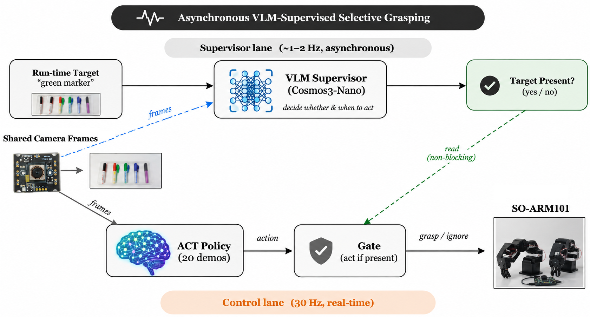

# Asynchronous VLM-Supervised Selective Grasping

Adding language-conditioned object selection to a **frozen** imitation policy — no retraining, no extra demonstrations. 
A vision-language model runs in parallel as a high-level supervisor and decides *whether* to act; a 20-demo ACT policy decides *how*.

<!-- optional: project page / paper / model / dataset badges -->
[](<PROJECT_PAGE_URL>)
<!--[](<PAPER_URL>)
[](<HF_MODEL_URL>)
[](<HF_DATASET_URL>)-->

<p align="center">
  
</p>

---

## Overview

An Action Chunking Transformer (ACT) policy reproduces a trained skill but has no notion of *which* object to act on — trained to pick an object, it grasps whatever is in front of it. Instead of making selection part of the policy (which needs large, instruction-annotated datasets), we keep the small policy **fixed** and delegate object selection to a VLM supervisor.

The two run **asynchronously**:

- A **30 Hz control loop** runs the ACT policy and owns the camera and arm.
- A **separate thread** queries the VLM (Cosmos3-Nano) on shared frames at ~1–2 Hz and updates a `target-present` flag.
- A **non-blocking gate** lets the policy act only when the requested target is present — so high-latency reasoning never stalls real-time control.

The same channel adds run-time retargeting, mid-task abort with return-to-home, and an optional shared-autonomy mode (human pause/take-over and online action blending).

## Key results

| Setting | Trials | Success | Transport slip | Grasp slip | Wrong color | Selection acc. |
|---|:--:|:--:|:--:|:--:|:--:|:--:|
| ACT only (baseline) | — | non-selective — grasps any color | | | | — |
| Single target | 50 | 27 (54%) | 10 (20%) | 13 (26%) | **0** | — |
| 3-color select | 25 | 13 (52%) | 7 (28%) | 5 (20%) | **0** | **100%** |

**VLM supervisor detection** (50 held-out frames, 25 present / 25 distractor-only): precision, recall, F1, accuracy all **1.00** — zero false activations on blue/pink distractor frames.

Every failure was a *physical* grasp slip on the upright markers, **not** a selection error. All selectivity comes from the supervisor at zero additional data cost — the policy is trained from only **20 demonstrations (~6 min of teleoperation)**.

## Hardware

- **Arm:** SO-ARM101 (WowRobo build of the LeRobot SO-101), 6-DoF, Feetech STS3215 servos, wrist RGB camera (640×480 @ 30 fps)
- **Compute:** single workstation with an NVIDIA RTX 5090

## Repository layout

```
cosmos_parallel_so101.py     # core: async control loop + parallel VLM thread + policy pipeline
cosmos_gui_so101.py          # GUI: color dropdown, live retargeting, pause/blend, mid-task abort
cosmos_server_so101.py       # Cosmos3-Nano HTTP server (/present, /locate) — runs in the GPU container
home.json                    # overlook/home pose
assets/                      # figures
```

## Setup

```bash
# 1. environment (Python 3.12) + LeRobot with Feetech support
conda create -y -n lerobot python=3.12 && conda activate lerobot
git clone https://github.com/huggingface/lerobot.git && cd lerobot
pip install -e ".[feetech]"

# 2. Blackwell (RTX 50-series) PyTorch
pip install --force-reinstall torch torchvision --index-url https://download.pytorch.org/whl/cu128
python -c "import torch; print(torch.cuda.get_device_capability(0), torch.cuda.is_available())"  # (12, 0) True
```

Start the Cosmos supervisor server (in its own GPU container/env), then confirm it is reachable:

```bash
python cosmos_server_so101.py          # serves /present on 0.0.0.0:5558
curl -s http://<COSMOS_HOST>:5558/health   # {"ok": true}
```

## Usage

**GUI (recommended):**

```bash
python cosmos_gui_so101.py
```

Pick a marker color, press **Play**. The arm holds at the overlook pose, the VLM watches in parallel, and the policy picks the target when it appears. Change the color live to retarget; use the manual panel to pause/take-over or nudge the arm during a pick.

**Headless:**

```bash
python cosmos_parallel_so101.py --target "green marker" --home home.json --episode-time 20
```

## Model & dataset

- **Trained ACT policy** — frozen policy from 20 demonstrations, with LeRobot pre/post-processors: `<HF_MODEL_URL>`
- **Demonstration dataset** — 20 episodes, 10,566 frames @ 30 fps, LeRobot format: `<HF_DATASET_URL>`

## Citation

```bibtex
@inproceedings{sanaullah2026vlmsupervised,
  title     = {Asynchronous Language-Conditioned Object Selection for
               Imitation Policies via a VLM Supervisor},
  author    = {Sanaullah and Kumar, Abhishek and Kim, Jeong Yong and
               Abbasi, Saad Jamshed and Han, Byung-Kil and Park, Dong Il},
  booktitle = {Preprint},
  year      = {2026}
}
```

## Acknowledgements

Built on [LeRobot](https://github.com/huggingface/lerobot) (ACT, SO-101) and NVIDIA Cosmos.
